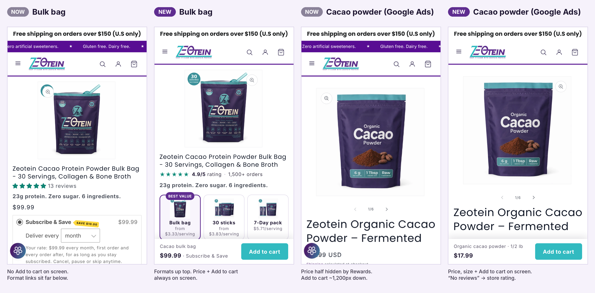
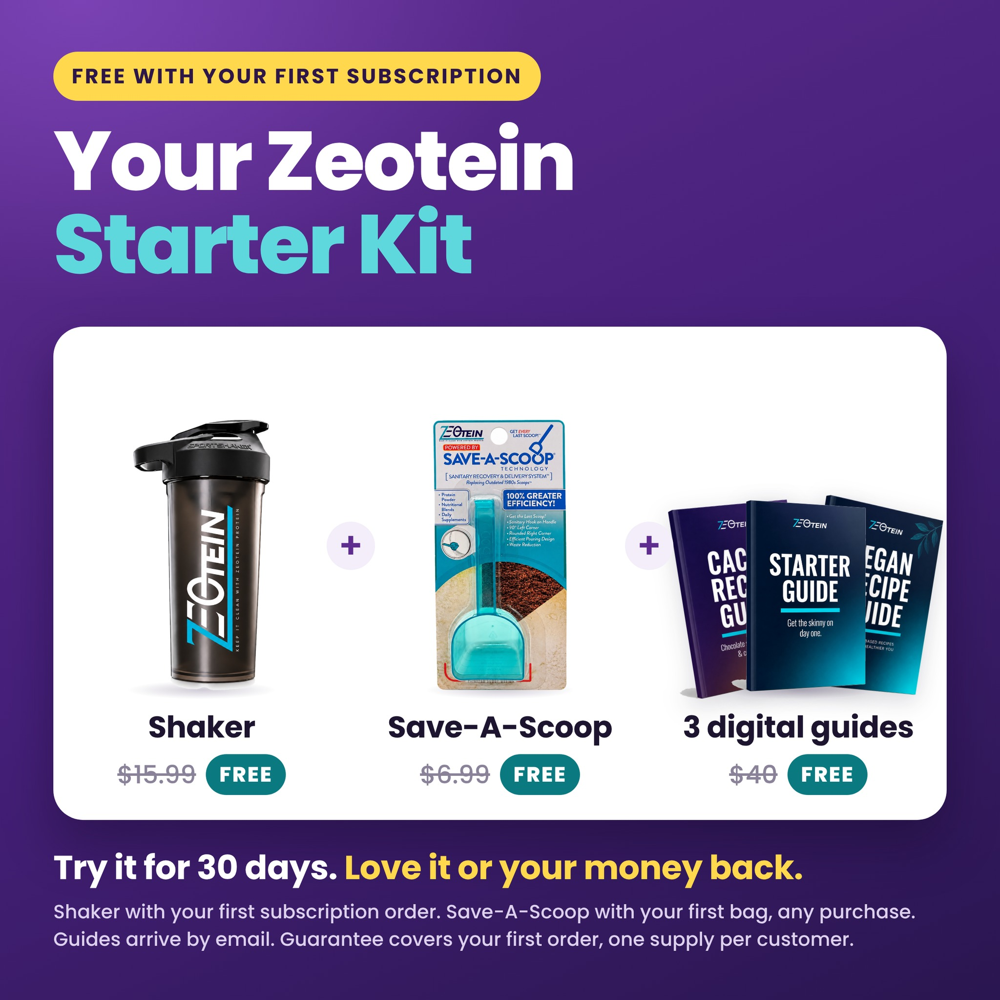
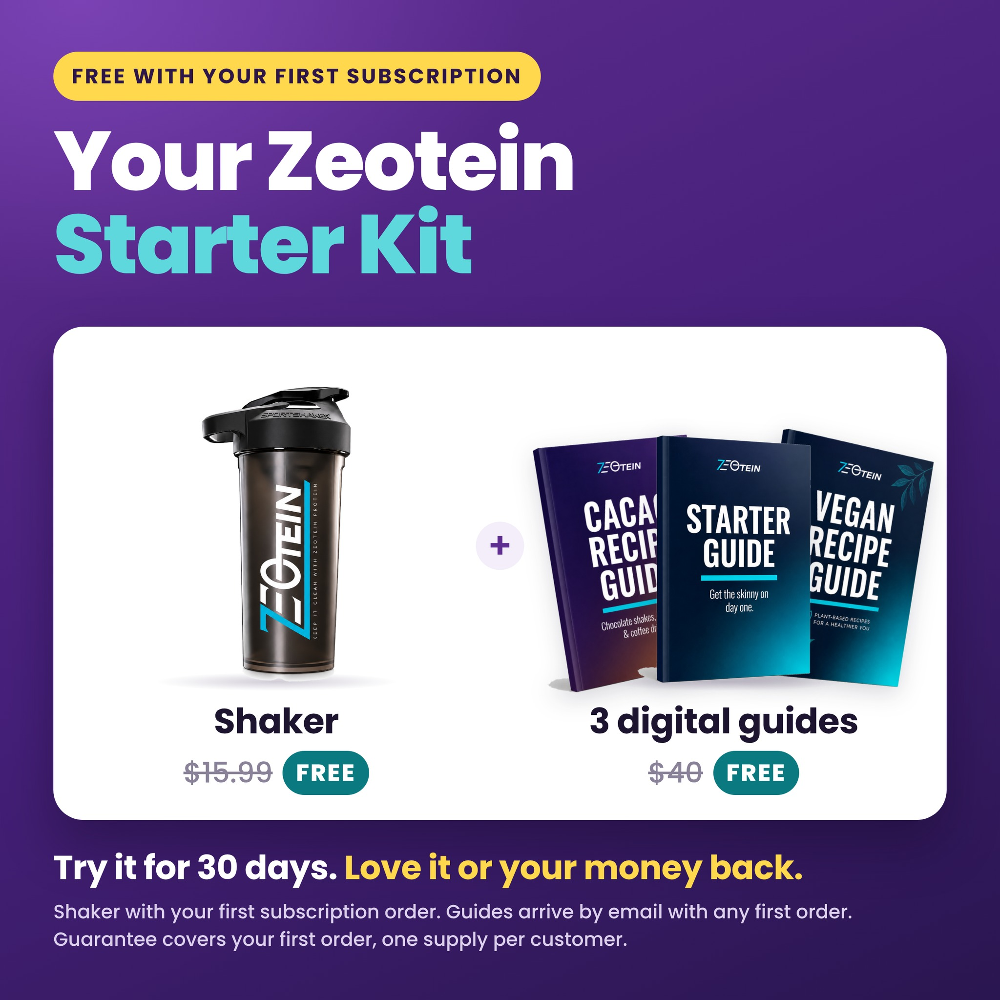

# Product pages v2 (November 13, 2026)

Built and checked in the unpublished preview theme **Live + script error fixes (Nov 10)** (`187923202261`). Nothing is live yet.

Preview links (phone or desktop):
- Bulk bag: https://zeotein.com/products/zeotein-cacao-bag-30?preview_theme_id=187923202261
- 30 sticks: https://zeotein.com/products/zeotein-cacao-sticks-30?preview_theme_id=187923202261
- 7-Day: https://zeotein.com/products/zeotein-cacao-sticks-7?preview_theme_id=187923202261
- Cacao powder (top Google Ads page): https://zeotein.com/products/organic-fermented-cacao-powder-premium-unsweetened?preview_theme_id=187923202261
- Zeolite (second Google Ads page): https://zeotein.com/products/zeolite?preview_theme_id=187923202261

In preview links, Shopify's grey preview bar sits at the bottom of the screen. The Add to cart bar sits just above it there. Live, the bar sits at the very bottom.

## What changed

### Cacao blend pages (bulk bag, 30 sticks, 7-Day)
| Area | Change |
|---|---|
| Format picker | Bulk bag / 30 sticks / 7-Day tiles moved right under the title, with photo and price per serving. "Best value" on the bag. |
| Gifts | The purple box inside Subscribe & Save is now **"Free Starter Kit with your first order"** with photos: shaker, Save-A-Scoop, 3 guides, each with its store price struck through. One-time keeps its own line. |
| Add to cart above the fold | A bar with price, plan and Add to cart stays on screen until the main button scrolls into view. On phones it runs full width. On desktop it floats over the photo column, so it never covers the buy box. |
| Reviews | "★★★★★ 4.9/5 rating · 1,500+ orders" replaces the per-product count ("13 reviews"), plus one real, verified customer quote under the button. |
| Layout | Quantity and Add to cart on one row. The duplicate price line is hidden when the subscription box shows prices. The desktop photo column narrows from "large" to "medium" so the buy box is wider, with a slightly smaller desktop title. The Rewards button and the second scrolling top bar are hidden on phones on these pages. |
| Trust row | "30-day guarantee on your first order" + "Ships in 1–2 business days" (the 7-Day packs are covered, per Dana's rule). |

### Single-ingredient pages (cacao powder, zeolite)
| Area | Change |
|---|---|
| Reviews | "No reviews" / "1 review" badge hidden. Shows "★★★★★ 4.9/5 **store** rating · 1,500+ orders". It's labelled "store" because these products have few reviews of their own. |
| Add to cart above the fold | Same bar, with the chosen size and price ("Organic cacao powder · 1/2 lb · $17.99"). It follows the size picker. |
| Order | Add to cart now sits right under the size picker. Before, it came after the serving chips, about 1,200px down on a phone. |
| Shipping | The two text lines became one row: "Free U.S. shipping on orders $150+" + "Ships in 1–2 business days". No guarantee wording: single-ingredient powders are final sale. |

### Things deliberately left alone
- Prices, Seal plans, discounts, product titles, handles.
- Starter Kit funnel products that share these templates (`zeotein-cacao-bag-30-try`, `-intro`, `zeotein-cacao-sticks-30-web`): no format tiles, so funnel shoppers aren't sent to the regular pages. They get the gift box once, the rating line and the bar.
- The other 7 single-ingredient pages: the same change is ready to roll out once Dana likes these two.

## Starter Kit gallery image (needs Dana's yes)
`images/starter-kit-bag.jpg` (bag) and `images/starter-kit-sticks.jpg` (sticks): real product photos of the shaker, Save-A-Scoop and the three guide covers, with the "Try it for 30 days" guarantee line and fine print matching the refund policy. Proposed: replace the text-only "Try it for 30 days" image (currently 5th) and move it to 2nd. This changes live product media, so it waits for approval.

| Bag | Sticks |
|---|---|
|  |  |

## Files
| File | Notes |
|---|---|
| `files/snippets/zt-buybox-tidy.liquid` | New. Parts: rating, formats, perks, trust, review, sticky (the sticky part also carries the shared layout CSS). |
| `files/templates/product.zeotein-cacao-30-day-bag.json` | Bulk bag template |
| `files/templates/product.cacao-30-day.json` | 30 sticks template |
| `files/templates/product.cacao-7-day.json` | 7-Day template |
| `files/templates/product.organic-cacao.json` | Cacao powder |
| `files/templates/product.zeolite.json` | Zeolite |

The live copies of all five templates are unchanged since Nov 5 (same checksums as the preview copies), so whole-file replacement is safe. Old blocks are kept as disabled blocks, so any of them can be switched back on in the theme editor.

## Checked (Nov 13, preview theme)
- Phone (390 px) and desktop (1440 and 1280 px) on all six affected pages. No new script errors.
- The Add to cart bar shows at load when the main button is below the fold, hides when the main button is visible, and comes back after scrolling past it.
- Cart: Subscribe & Save (monthly) from the bar adds "1 bag every 30 days" at $99.99. One-time from the bar adds $109.99 with no plan. The test cart was cleared.
- The size picker updates the bar ("1 lb · $28.99" cacao powder, "1 lb · $64.99" zeolite).
- Both featured reviews are verified buyers in Judge.me (Elsie U., bulk bag. Melissa M., 7-Day).
- Compliance scrub: no health, detox or disease claims added. The guarantee only appears on blend pages.

## How it goes live (after Dana's yes)
1. Live theme (needs someone with live access): Edit code → add `snippets/zt-buybox-tidy.liquid`, replace the five templates with the files here. Check one page on a phone.
2. Same day, Black Friday theme `187825914069` (Claude can write it): same six files. Its five templates are identical to live's.
3. Starter Kit image: on Dana's yes, Claude uploads it to the bag and sticks products and reorders the gallery.
